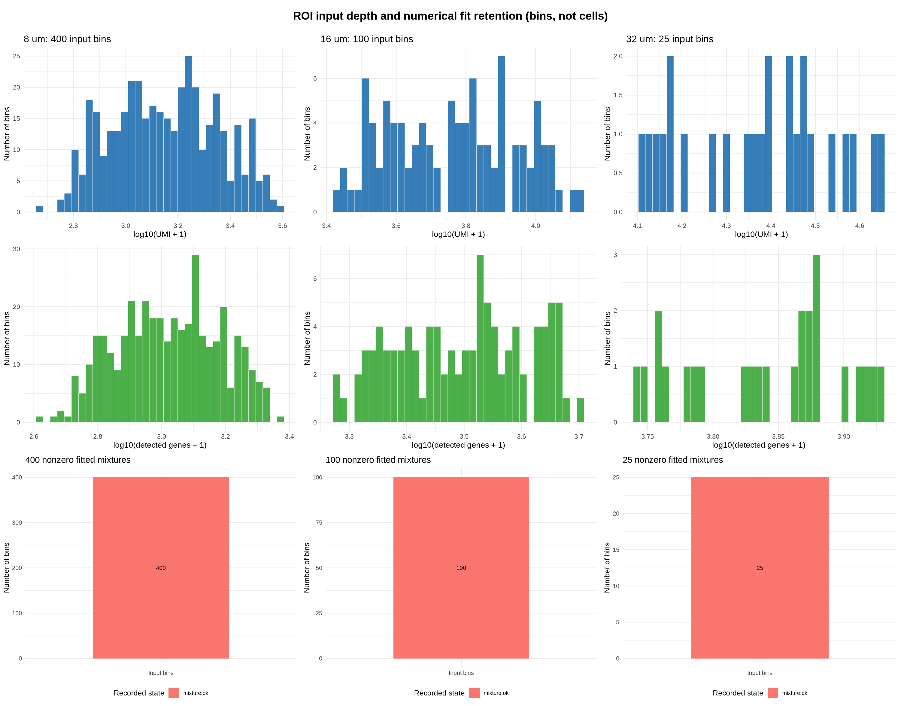
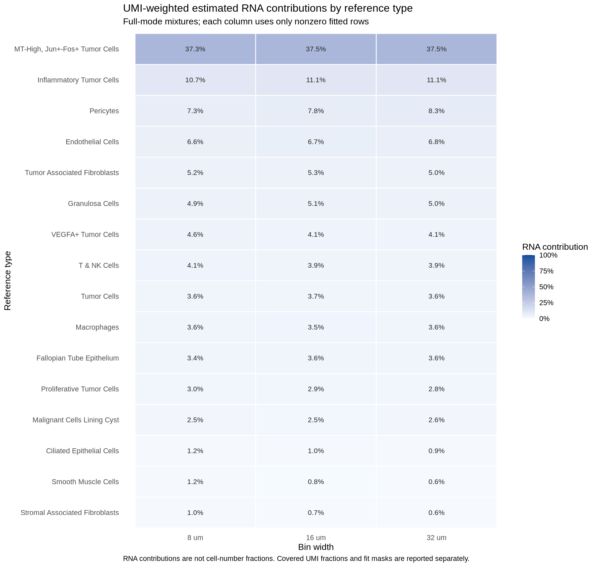
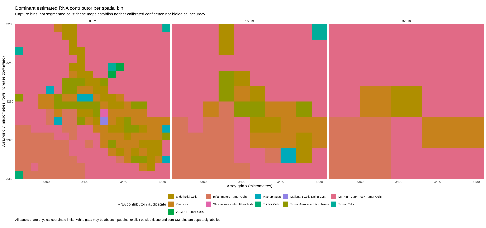

# Visium HD engineering validation — 10 November 2026

SpatialESS 0.1.4.9002 was tested on Ubuntu 24.04 with R 4.5.3 and the original
`dmcable/spacexr` 2.2.1 API. These results establish matrix-processing and numerical
fidelity on the stated sample and ROI. They do not establish biological accuracy.

## Dataset and inputs

The public [10x Human Ovarian Cancer FF deep-sequencing dataset](https://www.10xgenomics.com/datasets/visium-hd-cytassist-gene-expression-ovarian-cancer-discovery-fresh-frozen)
was processed with Space Ranger 4.0.1. The official binned archive was verified in
full: 23,648,788,575 bytes, MD5 `30cc5261863a716cadb7c95a9d9aaf1c`.
The matching feature-slice file was independently verified against its official
MD5 `87d6a05ad56816364caedeacfef5a71a`.

The annotated ovarian scFFPE reference retained 11,214 cells and 16 types after
explicit filtering (UMI >=100, >=25 cells/type, at most 1,000 cells/type, seed 42).
Slash-containing labels were mapped without merging distinct types. Spatial
inputs contained 18,132 feature IDs; 18,021 were shared with the reference before
RCTD's internal gene selection. No normalized expression was used as counts.

## Checks and results

| Check | Scope | Result |
|---|---|---|
| R unit suite |1,010 assertions|0 failures/errors/warnings/skips|
| raw8→native16 |whole slice, raw policy, 175,561 bins|all integer counts, genes, barcodes and tissue masks exact|
| raw8→native16 |whole slice, filtered policy, 113,644 bins|all integer counts, genes, barcodes and tissue masks exact|
| native8/native16/aggregated32 CLI |same 160×160µm ROI,400/100/25 bins|independent full fits; 629,442 input UMI at each resolution|
| original RCTD full/doublet |8/16/32µm,64/100/25 bins respectively|all 6 checks pass; maximum normalized-weight difference 3.33e-16; 0 status or dominant-label differences|
| raw8→32 versus native16→32 |same ROI|counts and tissue masks exact; cross-route consistency only|

The bin8 numerical audit uses a 64-bin subrectangle; the production CLI uses the
complete 400-bin ROI. The audit tolerance 1e-8 is a project setting, not an official
RCTD acceptance standard. Doublet native classifications and pair weights were
also checked. Real-data audits covered full and doublet; multi was previously
compared with upstream on synthetic data.

All fits used max_cores=1, seed 1, min_umi 100, min_genes 10 and batch_size 64.
OMP/OpenBLAS/MKL threads were 1; at most 2 real audit tasks ran concurrently.
Raw UMI counts were summed on the aligned grid before independent fitting.

The original constructors can warn that nUMI differs from column sums after
feature intersection. Here the full library totals were intentionally retained:
nonshared features contributed 2.059% of spatial UMI and 0.1165% of reference UMI.
The same convention was used for the independent upstream comparison.

## Interpretation and limits

The official archive contains no native32. The 32µm cross-route check is not an
independent Space Ranger custom32 comparison. That comparison remains to be added.
Whole-slice checks here concern count processing; RCTD was fitted on ROIs, not
benchmarked over the full slice. Resource measurements apply only to their named
commands and include their full process. A complete CLI ROI run took 7m57s with
2.316 GiB peak RSS; this is not a full-slice performance claim.

Full weights are estimated relative RNA contributions, not cell-number fractions.
`ok`, a nonzero mixture, and the largest weight are not calibrated confidence or
accuracy. Different resolutions of the same tissue are nested technical
observations, not independent biological replicates. Marker/histology or
orthogonal validation and independent samples are still needed for biological
claims and selecting bin size. Dominant-bin communication uses mixed bin
expression and does not reconstruct cell-type-specific expression or contacts.

## Reproduction materials

The adjacent TSV files contain public summaries with machine-specific paths
removed. Raw data, reference matrices, full fits, machine logs and private
configuration files are not bundled here. Existing repository material is
preserved separately from these summaries.

Run `scripts/validate_visium_hd_binning.R` against genuine native targets and
`scripts/run_visium_hd_rctd.R` with the documented config. The original same-input
audit and ROI/QC scripts are under `reproduction/`; see its README. The workflow
and upstream commit are described in [the server guide](../../VISIUM_HD_RCTD.md).
Cloud CI results are recorded on the corresponding pull request and in the repository Actions tab; the server measurements above retain their stated scope.

